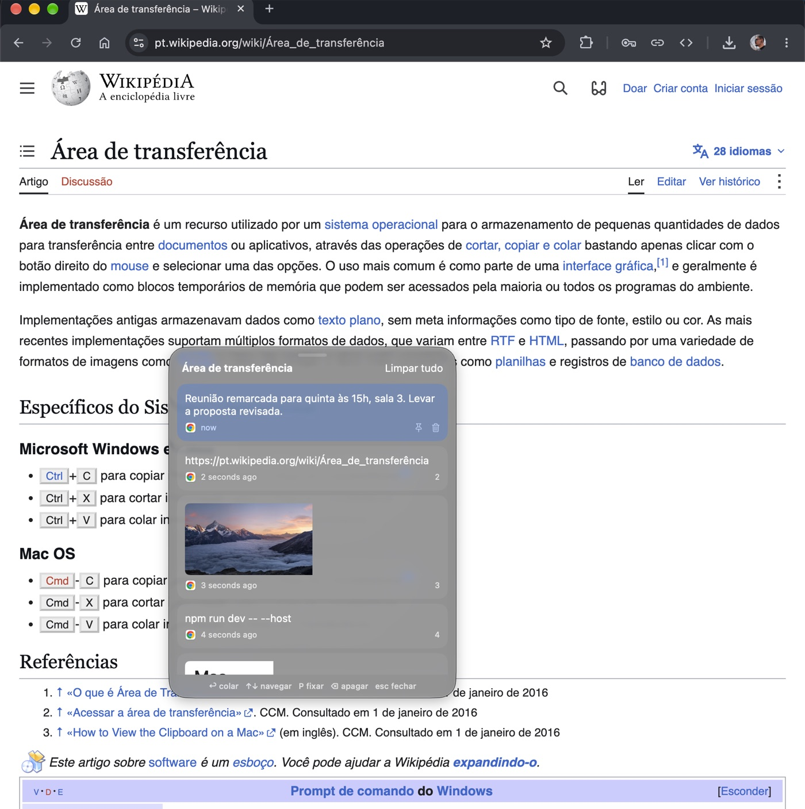

<div align="center">


# OptPaste

**Tudo o que você copia, a um atalho de distância.**

Histórico da área de transferência para Mac que abre com <kbd>⌥</kbd> <kbd>V</kbd>, por cima de qualquer app.

[](https://github.com/alirioguerra/OptPaste/releases/latest)


[**Baixar**](https://optpaste.pages.dev/downloads/OptPaste.dmg) · [Site](https://optpaste.pages.dev) · [Versões](https://github.com/alirioguerra/OptPaste/releases) · [English](README.md)

<br />



</div>

---

> [!WARNING]
> **O OptPaste ainda não é assinado com um Apple Developer ID nem notarizado pela Apple.** O app é seguro e todo o código está aqui, mas o macOS vai bloqueá-lo na primeira vez que você abrir. Veja [Abrindo o OptPaste pela primeira vez](#abrindo-o-optpaste-pela-primeira-vez) abaixo.

## Por quê

No Windows, <kbd>⊞ Win</kbd> + <kbd>V</kbd> abre uma janela com suas últimas cópias, e um clique cola a que você escolher. O Mac não tem nada parecido à mão. O OptPaste traz essa experiência para o macOS: copiou algo há dez minutos e já sobrescreveu? Aperte <kbd>⌥</kbd> <kbd>V</kbd> e cole de novo.

## Recursos

| | |
|---|---|
| ⌨️ **Um atalho, de qualquer app** | <kbd>⌥</kbd> <kbd>V</kbd> abre o histórico onde você estiver. Prefere outra combinação? Grave a sua. |
| 📋 **Cola por você** | Escolha um item e ele é colado direto no app em que você estava, ou só copiado, se preferir. |
| 📌 **Fixe o que importa** | Endereços, respostas prontas, trechos de código: itens fixados ficam no topo e sobrevivem ao "Limpar tudo". |
| 🖼️ **Textos, imagens e arquivos** | Tudo o que passa pela área de transferência, com o ícone do app de origem e quando foi copiado. |
| 🔒 **Senhas mascaradas** | O que vem de gerenciadores de senha aparece oculto, ou nem é guardado. |
| ✂️ **Recortar e colar no Finder** | <kbd>⌘</kbd> <kbd>X</kbd> e depois <kbd>⌘</kbd> <kbd>V</kbd> move arquivos, como no Windows. |
| 🪶 **Leve e discreto** | Fica na barra de menus, abre com o sistema e guarda de 10 a 200 itens. |
| 🔄 **Atualização automática** | Versões novas se instalam sozinhas pelo [Sparkle](https://sparkle-project.org). |
| 🌐 **Português e inglês** | Segue o idioma do sistema. |

## Atalhos

| Teclas | Ação |
|---|---|
| <kbd>⌥</kbd> <kbd>V</kbd> | Abrir o histórico |
| <kbd>↑</kbd> <kbd>↓</kbd> | Navegar pelos itens |
| <kbd>↩</kbd> | Colar o item selecionado |
| <kbd>1</kbd> … <kbd>9</kbd> | Colar pela posição |
| <kbd>P</kbd> | Fixar ou desafixar |
| <kbd>⌫</kbd> | Apagar do histórico |
| <kbd>esc</kbd> | Fechar |

## Privacidade

Seu histórico nunca sai do seu Mac.

- Tudo o que o OptPaste grava em disco é criptografado com **AES-256-GCM**, com uma chave gerada no seu Mac e guardada no seu Keychain.
- Sem conta, sem servidor, sem telemetria. O app só acessa a internet para procurar versões novas.
- É open source: você não precisa confiar na minha palavra, leia o código.

## Instalação

1. Baixe o [**OptPaste.dmg**](https://optpaste.pages.dev/downloads/OptPaste.dmg) (ou pegue em [Versões](https://github.com/alirioguerra/OptPaste/releases/latest)).
2. Abra o `.dmg` e arraste o **OptPaste** para **Aplicativos**.
3. Abra o app e, na primeira vez, siga os passos abaixo.

Requer **macOS 14 Sonoma** ou mais recente.

### Abrindo o OptPaste pela primeira vez

Como o app ainda não é assinado com um Developer ID nem notarizado pela Apple, o Gatekeeper mostra um aviso como *"A Apple não pôde verificar se o OptPaste está livre de malware"*. Para abrir mesmo assim:

**macOS 15 Sequoia ou mais recente**

1. Abra o OptPaste uma vez e clique em **OK** no aviso.
2. Vá em **Ajustes do Sistema → Privacidade e Segurança**.
3. Role até a mensagem sobre o OptPaste, clique em **Abrir Mesmo Assim** e confirme com sua senha.

**macOS 14 Sonoma**

- Clique com o botão direito (ou <kbd>⌃</kbd>-clique) no OptPaste em Aplicativos, escolha **Abrir** e depois **Abrir** de novo.

**Ou pelo Terminal**

```sh
xattr -dr com.apple.quarantine /Applications/OptPaste.app
```

Isso só é preciso uma vez. As atualizações pelo Sparkle continuam verificadas: o app só instala versões assinadas com a chave EdDSA do projeto.

### Permissões

Na primeira execução o OptPaste pede acesso de **Acessibilidade** (Ajustes do Sistema → Privacidade e Segurança → Acessibilidade). Ele serve só para enviar <kbd>⌘</kbd> <kbd>V</kbd> ao app em que você estava, para o item ser colado por você. Sem essa permissão o OptPaste continua funcionando e só copia o item.

## Compilar a partir do código

```sh
git clone https://github.com/alirioguerra/OptPaste.git
cd OptPaste
open OptPaste.xcodeproj
```

Ou pela linha de comando:

```sh
xcodebuild -scheme OptPaste -configuration Debug build
```

O Sparkle vem pelo Swift Package Manager, então o Xcode resolve na primeira build. Escolha seu próprio time de assinatura em **Signing & Capabilities**.

## Apoie

O OptPaste é e sempre será gratuito. Se ele te ajuda e você quiser apoiar:

<a href="https://www.buymeacoffee.com/alirioguerra" target="_blank"></a>

Pagar uma conta de desenvolvedor da Apple é o que vai permitir assinar e notarizar o app, e aí o aviso acima some.

---

<div align="center">
Feito por <a href="https://alirioguerra.github.io">Alírio Guerra</a>
</div>
